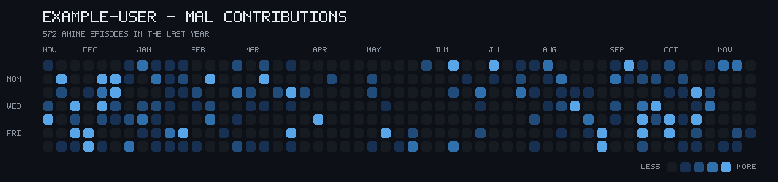

# MAL Heatmap — ปฏิทิน Contribution สไตล์ GitHub สำหรับ MyAnimeList

สร้างปฏิทินสีแบบหน้าโปรไฟล์ GitHub จากจำนวน **Episode อนิเมะที่คุณดูในแต่ละวัน** บน MyAnimeList (MAL) แล้วเผยแพร่เป็นรูป PNG และหน้าเว็บบน GitHub Pages ให้ฝังในโปรไฟล์ MAL ได้ ทำงานอัตโนมัติบน GitHub Actions โดยไม่ต้องมีเซิร์ฟเวอร์ ไม่ต้องใช้ฐานข้อมูล และไม่ต้องใช้รหัสผ่านหรือ API Key ของ MAL



> รูปด้านบนสร้างจากข้อมูลสมมุติ ไม่ใช่ข้อมูลของบัญชีจริง

## สารบัญ

1. [ทำงานอย่างไร](#ทำงานอย่างไร)
2. [สิ่งที่ต้องมี](#สิ่งที่ต้องมี)
3. [เริ่มใช้กับบัญชี MAL ของคุณ](#เริ่มใช้กับบัญชี-mal-ของคุณ)
4. [ตั้งให้รันอัตโนมัติด้วย cron-job.org](#ตั้งให้รันอัตโนมัติด้วย-cron-joborg)
5. [PAT หมดอายุ หรือย้ายเครื่อง/ย้ายบริการ ต้องทำอย่างไร](#pat-หมดอายุ-หรือย้ายเครื่องย้ายบริการ-ต้องทำอย่างไร)
6. [วิธีนับ Contribution](#วิธีนับ-contribution)
7. [ช่วงเวลาที่แสดงและรูปรายปี](#ช่วงเวลาที่แสดงและรูปรายปี)
8. [ข้อมูลที่เก็บและความเป็นส่วนตัว](#ข้อมูลที่เก็บและความเป็นส่วนตัว)
9. [ระบบป้องกันข้อผิดพลาด](#ระบบป้องกันข้อผิดพลาด)
10. [แก้ปัญหาเบื้องต้น](#แก้ปัญหาเบื้องต้น)
11. [ข้อจำกัด](#ข้อจำกัด)
12. [พัฒนาและทดสอบในเครื่อง](#พัฒนาและทดสอบในเครื่อง)
13. [โครงสร้างไฟล์](#โครงสร้างไฟล์)
14. [แหล่งอ้างอิง](#แหล่งอ้างอิง)

## ทำงานอย่างไร

MAL API ทางการไม่เปิดเผยประวัติว่า "ดูตอนไหนเมื่อไหร่" แต่หน้าโปรไฟล์สาธารณะของ MAL แสดง **Recent History** ย้อนหลังประมาณ 21 วัน โปรเจกต์นี้จึงดึงข้อมูลส่วนนั้นมาสะสมเก็บไว้เอง

```text
cron-job.org ──(ทุก 3 ชั่วโมง เรียก API)──► GitHub Actions: workflow_dispatch
                                              │
   (ตัวสำรอง: GitHub schedule วันละครั้ง) ───►│
                                              ▼
                 1. รันเทสต์
                 2. ดาวน์โหลด + Build Toki ชั่วคราวใน Runner
                 3. Node.js ดึง Recent History จาก Toki
                 4. ตรวจความผิดปกติ → กันนับซ้ำ → บวกยอดรายวัน
                 5. Commit data/state.json (เฉพาะเมื่อยอดเปลี่ยน)
                 6. สร้าง PNG + หน้าเว็บ แล้ว Deploy ขึ้น GitHub Pages
```

| ส่วนประกอบ | หน้าที่ |
|---|---|
| **Toki** ([nyawave/toki](https://github.com/nyawave/toki)) | โปรแกรม Go ของบุคคลที่สาม แปลงหน้า Recent History สาธารณะของ MAL เป็น JSON ไม่ใช่ API ทางการและไม่เกี่ยวข้องกับ MAL จะถูก Build และรันชั่วคราวใน Runner ทุกครั้ง ไม่ได้เปิดค้างบนอินเทอร์เน็ต |
| **Node.js (โค้ดในโปรเจกต์นี้)** | ดึงข้อมูล ตรวจสอบ กันนับซ้ำ สร้างรูปและเว็บ ไม่มีไลบรารี npm ภายนอก |
| **`data/state.json`** | ฐานข้อมูลของโปรเจกต์ เก็บยอดรายวันสะสมไว้ใน Git จึงอยู่ต่อแม้ MAL ลบประวัติเก่าทิ้งแล้ว |
| **GitHub Pages** | เผยแพร่หน้าเว็บและ `heatmap.png` |
| **cron-job.org** | ตัวสั่งงานหลัก เรียก GitHub ให้เริ่มรันตามเวลา (เพราะ `schedule` ของ GitHub เลื่อนหรือข้ามรอบได้) |
| **GitHub `schedule`** | ตัวสำรองวันละครั้ง เผื่อ cron-job.org หยุดทำงาน |

## สิ่งที่ต้องมี

- บัญชี GitHub และ **Public Repository** (GitHub Pages แบบฟรีต้องใช้ Public)
- บัญชี MAL ที่ตั้ง **โปรไฟล์และ Recent History เป็นสาธารณะ** (ถ้าเป็นส่วนตัว Toki จะอ่านไม่ได้)
- บัญชี [cron-job.org](https://cron-job.org) (ฟรี) สำหรับสั่งงานอัตโนมัติ
- สำหรับรันเทสต์ในเครื่อง: Node.js 22 ขึ้นไป (ไม่จำเป็นถ้าใช้แค่บน GitHub)

## เริ่มใช้กับบัญชี MAL ของคุณ

ในเอกสารนี้ `<USERNAME>` คือชื่อผู้ใช้ MAL ของคุณ ส่วน `<GITHUB_USER>` และ `<REPO>` คือชื่อบัญชี GitHub และชื่อ Repository ของคุณ

### 1. Fork หรือคัดลอก Repository

กด **Fork** (หรืออัปโหลดไฟล์ทั้งหมดเข้า Repository ใหม่) โดยให้ Branch หลักชื่อ `main`

### 2. ⚠️ แทนที่ `data/state.json` ด้วยไฟล์เริ่มต้นของคุณ (สำคัญมาก)

ไฟล์ `data/state.json` ที่ติดมากับ Repository ต้นทางคือประวัติของเจ้าของเดิม **ห้ามใช้ต่อ** ให้ลบเนื้อหาแล้วใส่ไฟล์เริ่มต้นนี้แทน:

```json
{
  "schema_version": 2,
  "username": "<USERNAME>",
  "auto_sync_start_date": "2026-01-01",
  "seen_events": {},
  "daily": {}
}
```

- `username` ต้องตรงกับชื่อผู้ใช้ MAL (ตัวพิมพ์เล็ก/ใหญ่เหมือนกัน) และตรงกับค่าในขั้นตอนที่ 3 ถ้าไม่ตรงกัน ระบบจะหยุดเพื่อป้องกันการปนข้อมูลคนละบัญชี
- `auto_sync_start_date` (รูปแบบ `YYYY-MM-DD`) คือ **วันที่เก่าที่สุดที่อนุญาตให้ระบบนำเข้า** กิจกรรมก่อนวันนี้จะถูกข้าม ควรตั้งเป็นวันที่ที่เก่ากว่ากิจกรรมที่ MAL ยังแสดงอยู่ (ประมาณ 21 วันย้อนหลัง) หรือวันที่คุณเริ่มใช้งาน **ควรใส่เองเสมอ** เพราะถ้าไม่ใส่ โค้ดจะใช้ค่าเริ่มต้นภายในซึ่งเป็นวันที่ของเจ้าของเดิม และอาจข้ามกิจกรรมของคุณไปโดยไม่รู้ตัว
- `seen_events` และ `daily` ปล่อยเป็น `{}` ระบบจะเติมเอง

ถ้าคุณมีประวัติเก่ากว่า 21 วันที่ MAL มองไม่เห็นแล้ว และอยากใส่เอง ให้เพิ่มลงใน `daily` ด้วยตัวเอง รูปแบบต่อวันคือ `"2026-01-10": { "anime": 3, "manga": 0, "total": 3 }` (`total` ต้องเท่ากับ `anime`) แล้วตั้ง `auto_sync_start_date` เป็นวันที่ **หลัง** ช่วงที่คุณกรอกเอง เพื่อไม่ให้ระบบนับซ้ำกับสิ่งที่กรอก

### 3. ตั้งชื่อผู้ใช้ MAL ใน Workflow

เปิด `.github/workflows/heatmap.yml` แล้วแก้ในขั้นตอน `Backfill recent MAL history, update calendar, and render site`:

```yaml
env:
  MAL_USERNAME: <USERNAME>
```

> ใน `src/run.js` มีค่าสำรอง (fallback) เป็นชื่อผู้ใช้ของเจ้าของเดิมอยู่ด้วย แต่จะไม่ถูกใช้ตราบใดที่ Workflow ตั้ง `MAL_USERNAME` ไว้ ควรแก้ให้เป็นของคุณเพื่อความสะอาด

### 4. เปิด GitHub Pages

**Settings → Pages → Build and deployment → Source → GitHub Actions**

### 5. (แนะนำ) Pin เวอร์ชัน Toki

Toki เป็นโค้ดบุคคลที่สามที่ถูกรันใน Runner การ Pin ให้ใช้เฉพาะโค้ดที่คุณตรวจแล้ว:

1. รันครั้งแรกโดยไม่ตั้งค่า แล้วดู Log ขั้นตอน `Download Toki history adapter` จะมีบรรทัด `::warning::` พร้อม SHA ที่ใช้อยู่
2. ตรวจโค้ดของ Toki ที่ SHA นั้น
3. ไปที่ **Settings → Secrets and variables → Actions → Variables** สร้าง Variable ชื่อ `TOKI_COMMIT` ค่าเป็น SHA 40 ตัวอักษร (ตัวพิมพ์เล็ก)

### 6. รันครั้งแรก

เปิดแท็บ **Actions → Build MAL Contributions → Run workflow** (Branch `main`) รอจนทุกขั้นตอนเป็นสีเขียว แล้วเปิดเว็บ:

- เว็บไซต์: `https://<GITHUB_USER>.github.io/<REPO>/`
- รูปภาพ: `https://<GITHUB_USER>.github.io/<REPO>/heatmap.png`
- BBCode สำหรับโปรไฟล์ MAL: `[img]https://<GITHUB_USER>.github.io/<REPO>/heatmap.png[/img]` (หน้าเว็บมีปุ่ม **Copy BBCode** ให้)

ในการรันครั้งแรก ระบบจะนำเข้าทุกอย่างที่ MAL แสดงอยู่ในช่วง ~21 วัน (ไม่เก่ากว่า `auto_sync_start_date`) ถ้าโปรไฟล์เป็นส่วนตัวหรือ MAL บล็อก Runner Workflow จะหยุดโดยไม่บันทึกอะไร

หลังจากนี้ให้ตั้งให้รันอัตโนมัติตามหัวข้อถัดไป

## ตั้งให้รันอัตโนมัติด้วย cron-job.org

ตัวสั่งงานหลักคือ cron-job.org ที่เรียก GitHub API เพื่อเริ่ม Workflow (`workflow_dispatch`) ทุก 3 ชั่วโมง

### A. สร้าง Personal Access Token (PAT)

1. GitHub → **Settings → Developer settings → Personal access tokens → Fine-grained tokens → Generate new token**
2. **Resource owner:** บัญชีของคุณ
3. **Expiration:** เลือกได้สองแบบ
   - **ตั้งวันหมดอายุ** (ปลอดภัยกว่า): ต้อง **จดวันนี้ไว้ในปฏิทิน** เตือนล่วงหน้าอย่างน้อย 1 สัปดาห์ แล้วเปลี่ยน Token ก่อนถึงวัน ดูหัวข้อ [PAT หมดอายุ](#pat-หมดอายุ-หรือย้ายเครื่องย้ายบริการ-ต้องทำอย่างไร)
   - **ไม่มีวันหมดอายุ** (No expiration): GitHub จะแสดงคำเตือนสีเหลือง "This token has no expiration date" ใช้ได้ไม่ต้องคอยต่ออายุ แต่ถ้า Token รั่วจะใช้ได้ต่อไปจนกว่าคุณจะลบเอง จึงควรให้สิทธิ์แคบตามข้อ 4-5 ด้านล่างเสมอ
4. **Repository access:** *Only select repositories* → เลือกเฉพาะ `<REPO>`
5. **Permissions → Repository permissions → Actions: Read and write** (สิทธิ์อื่นไม่ต้องให้)
6. กด Generate แล้ว **คัดลอก Token เก็บไว้ทันที** (ขึ้นให้ดูครั้งเดียว ขึ้นต้นด้วย `github_pat_`)

> **ตรวจสิทธิ์ให้ถูกต้อง:** หน้ารายละเอียด Token ควรแสดงเพียง Repository เดียวของคุณ, *This token does not have any user permissions*, และ Repository permissions เพียง *Read access to metadata* (GitHub ใส่ให้เอง) กับ *Read and Write access to actions* ถ้ามีสิทธิ์อื่นหรือเข้าถึงหลาย Repository ให้ลดลง
>
> Token ใช้สั่ง Workflow ได้เท่านั้น ห้ามใส่ลงใน Repository, Issue, ภาพหน้าจอ หรือที่สาธารณะใดๆ ถ้าเผลอเปิดเผยให้ลบ (Revoke) ทันทีแล้วสร้างใหม่

### B. (แนะนำ) ทดสอบ Token ด้วย curl ก่อน

```bash
curl -i -X POST \
  -H "Accept: application/vnd.github+json" \
  -H "Authorization: Bearer <TOKEN>" \
  -H "X-GitHub-Api-Version: 2022-11-28" \
  -d '{"ref":"main"}' \
  https://api.github.com/repos/<GITHUB_USER>/<REPO>/actions/workflows/heatmap.yml/dispatches
```

ถ้าสำเร็จจะได้ **`HTTP/2 204`** (ไม่มีเนื้อหาตอบกลับ) และมีรอบใหม่ขึ้นในแท็บ Actions

### C. สร้าง Cronjob ที่ cron-job.org

**แท็บ COMMON**

| ช่อง | ค่า |
|---|---|
| Title | ชื่ออะไรก็ได้ เช่น `mal-heatmap` |
| URL | `https://api.github.com/repos/<GITHUB_USER>/<REPO>/actions/workflows/heatmap.yml/dispatches` |
| Enable job | เปิด |
| Save responses in job history | เปิด (ช่วยดูสาเหตุเมื่อล้มเหลว) |
| Execution schedule | Every 3 hours (Crontab: `0 */3 * * *`) |

**แท็บ ADVANCED**

| ช่อง | ค่า |
|---|---|
| Time zone | เขตเวลาของคุณ (มีผลกับเวลาที่รัน) |
| Request method | `POST` |
| Request body | `{"ref":"main"}` |
| Timeout | 30 วินาที |
| Treat redirects as success | ปิด |

Headers (4 ตัว):

| Key | Value |
|---|---|
| `Accept` | `application/vnd.github+json` |
| `Authorization` | `Bearer <TOKEN>` |
| `Content-Type` | `application/json` |
| `X-GitHub-Api-Version` | `2022-11-28` |

**แท็บ NOTIFICATIONS** (แนะนำ)

- เปิด *execution of the cronjob fails* → Notify after **3** subsequent failures
- เปิด *the cronjob will be disabled because of too many failures*

กด **TEST RUN** ต้องได้สถานะสำเร็จ (HTTP 204) และมีรอบใหม่ขึ้นในแท็บ Actions แล้วกด **SAVE**

> ต้องการเปลี่ยนความถี่ แก้ที่ cron-job.org ได้อย่างเดียว ไม่ต้องแก้โค้ด MAL เก็บประวัติราว 21 วัน ดังนั้นแม้ตั้งห่างเป็นหลายชั่วโมงก็ไม่ทำให้ข้อมูลหาย เพียงแต่ Heatmap จะอัปเดตช้าลงตามรอบ

### D. ตัวสำรองใน GitHub (ไม่ต้องตั้งค่าเพิ่ม)

`heatmap.yml` มี `schedule` วันละครั้งเวลา **02:15 น. (Asia/Bangkok)** เป็นตัวสำรองเผื่อ cron-job.org หยุด ถ้าอยู่คนละเขตเวลา แก้ได้ที่ค่า `cron` และ `timezone` ในไฟล์นั้น (GitHub รองรับชื่อเขตเวลาแบบ IANA) ข้อควรรู้:

- GitHub อาจหน่วงหรือข้ามรอบของ `schedule` ได้ จึงใช้เป็นตัวสำรองเท่านั้น
- Repository สาธารณะที่ไม่มีความเคลื่อนไหวนาน 60 วัน GitHub จะปิด `schedule` อัตโนมัติ (อย่าสรุปว่า Commit ของบอตจะนับเป็นความเคลื่อนไหว) ถ้าถูกปิด ให้เข้าแท็บ Actions แล้วเปิด Workflow อีกครั้ง
- ถ้า PAT ใช้ไม่ได้ (หมดอายุ ถูกลบ หรือถูกเพิกถอน) ตัวสำรองยังรันวันละครั้ง ข้อมูลจึงไม่หาย แต่ Heatmap จะอัปเดตช้าลงมาก ควรรีบเปลี่ยน PAT ตามหัวข้อถัดไป

## PAT หมดอายุ หรือย้ายเครื่อง/ย้ายบริการ ต้องทำอย่างไร

### PAT ใช้ไม่ได้ได้จากสาเหตุอะไรบ้าง

- **หมดอายุ** (เฉพาะ Token ที่ตั้งวันหมดอายุไว้) ถ้าตั้งเป็น No expiration ข้อนี้จะไม่เกิด
- ถูกลบ หรือถูกกด **Regenerate token** (Token เดิมใช้ไม่ได้ทันที)
- ถูก GitHub เพิกถอนเอง (เช่น ตรวจพบว่ารั่วใน Repository สาธารณะ)
- ผู้ที่เป็นเจ้าของ Token ถูกลบ/ระงับบัญชี หรือ Repository ถูกย้าย/เปลี่ยนชื่อ
- แก้ Header ที่ cron-job.org ผิด (เช่น ลืมคำว่า `Bearer ` หรือคัดลอก Token ไม่ครบ)

### จะรู้ได้อย่างไรว่า PAT มีปัญหา

1. **อีเมลจาก cron-job.org** (ทางหลัก): cron-job.org ได้ HTTP **401** ใน Job history แล้วส่งอีเมลหลังล้มติดกัน 3 ครั้ง ถ้าเปิดแจ้งเตือนไว้ (ตามรอบ 3 ชั่วโมงคือราว 9 ชั่วโมงหลังเริ่มพัง) **อย่าปิดการแจ้งเตือนนี้** เพราะเป็นทางเดียวที่จะรู้ได้กรณี Token ไม่มีวันหมดอายุ
2. **ดู Job history ที่ cron-job.org** ว่าสถานะล่าสุดเป็น 204 หรือไม่
3. **ดูแท็บ Actions** ถ้ารอบแบบ `workflow_dispatch` หายไปและเหลือแต่รอบ `schedule` วันละครั้ง แปลว่า Token มีปัญหา
4. **GitHub → Settings → Developer settings → Fine-grained tokens** จะเห็นวันหมดอายุ (หรือสถานะ Expired) ของแต่ละ Token และ GitHub มักส่งอีเมลเตือนก่อน Token ที่มีวันหมดอายุจะหมด (ตรวจว่าอีเมลไม่ตกไปอยู่ใน Spam และไม่ควรพึ่งอีเมลนี้อย่างเดียว)
5. **ทดสอบทันที:** รัน curl ในขั้นตอน [B](#b-แนะนำ-ทดสอบ-token-ด้วย-curl-ก่อน) หรือกด **TEST RUN** ที่ cron-job.org ได้ `204` คือปกติ ได้ `401` คือใช้ไม่ได้

### ผลกระทบเมื่อ PAT ใช้ไม่ได้

Heatmap อัปเดตเหลือแค่ตัวสำรองวันละครั้ง ข้อมูลไม่หายตราบใดที่ยังรันได้อย่างน้อยหนึ่งครั้งในทุก ~20 วัน

### วิธีเปลี่ยน/ต่ออายุ PAT

1. สร้าง Fine-grained PAT ใหม่ตามขั้นตอน [A](#a-สร้าง-personal-access-token-pat) (Repository เดียว, Actions: Read and write)
2. ทดสอบด้วย curl ตามขั้นตอน [B](#b-แนะนำ-ทดสอบ-token-ด้วย-curl-ก่อน) ให้ได้ `204`
3. cron-job.org → เปิด Cronjob → แท็บ **ADVANCED** → แก้ค่า Header `Authorization` เป็น `Bearer <TOKEN ใหม่>`
4. กด **TEST RUN** ให้สำเร็จ แล้วกด **SAVE**
5. ลบ Token เก่าที่ GitHub (Settings → Developer settings → Fine-grained tokens)
6. ถ้าตั้งวันหมดอายุไว้ ให้จดวันนั้นลงปฏิทิน (เตือนล่วงหน้าอย่างน้อย 1 สัปดาห์) ถ้าเลือก No expiration ไม่ต้องจด แต่ควรตรวจสิทธิ์ของ Token ตามหมายเหตุในขั้นตอน A

### รหัสตอบกลับที่พบบ่อย

| HTTP | ความหมาย | วิธีแก้ |
|---|---|---|
| 204 | สำเร็จ | ไม่ต้องทำอะไร |
| 401 | Token หมดอายุ / ผิด / ถูกเพิกถอน | สร้าง Token ใหม่ตามขั้นตอนด้านบน |
| 403 | Token ไม่มีสิทธิ์ Actions: Read and write หรือถูกจำกัดการเข้าถึง | แก้สิทธิ์ของ Token |
| 404 | URL ผิด ชื่อ Repository/Workflow ผิด หรือ Token ไม่ได้รับสิทธิ์กับ Repository นี้ | ตรวจ URL (`<GITHUB_USER>/<REPO>/…/heatmap.yml/dispatches`) และ Repository access ของ Token |
| 422 | `ref` ผิด หรือ Workflow ไม่มี `workflow_dispatch` | ใช้ `{"ref":"main"}` และตรวจว่าไฟล์ Workflow ยังมี `workflow_dispatch:` |

### ย้ายเครื่องคอมพิวเตอร์

ระบบทั้งหมดทำงานบน GitHub และ cron-job.org ไม่ได้ผูกกับเครื่องของคุณ จึง **ไม่ต้องย้ายหรือตั้งค่าอะไรในระบบ** แค่ `git clone` Repository ไปเครื่องใหม่ ข้อมูลทั้งหมดอยู่ใน Git อยู่แล้ว (ก่อนแก้และ push ควร `git pull` ก่อนเสมอ เพราะ Workflow Commit `data/state.json` เข้า `main` อยู่ตลอด)

### ย้ายไปบัญชี cron-job.org ใหม่ หรือใช้บริการอื่นแทน

สร้างงานใหม่ด้วยค่าตามตารางในขั้นตอน [C](#c-สร้าง-cronjob-ที่-cron-joborg) ได้เลย (บริการใดก็ได้ที่ส่ง HTTP POST พร้อม Header และ Body ตามนั้นได้) ใช้ PAT เดิมหรือสร้างใหม่ก็ได้ แล้วปิดงานเก่าเพื่อไม่ให้ยิงซ้ำ ที่ cron-job.org มีปุ่ม **IMPORT FROM CURL** วางคำสั่ง curl จากขั้นตอน B เข้าไปเพื่อกรอกค่าให้อัตโนมัติได้

### ย้าย Repository / เปลี่ยนชื่อ Repository หรือบัญชี GitHub

- แก้ URL ใน cron-job.org ให้ชี้ไปที่ `<GITHUB_USER>/<REPO>` ใหม่
- Token ผูกกับ Repository เดิม ถ้าย้ายหรือเปลี่ยนเจ้าของ ให้สร้าง Token ใหม่
- URL ของหน้าเว็บ รูป และ BBCode บนโปรไฟล์ MAL จะเปลี่ยนตาม ต้องอัปเดตโปรไฟล์ MAL ด้วย
- อย่าลืมคัดลอก `data/state.json` ไปด้วย (ถ้าหาย ประวัติเก่ากว่า 21 วันจะกู้จาก MAL ไม่ได้)

### เปลี่ยนบัญชี MAL

1. แก้ `MAL_USERNAME` ใน `.github/workflows/heatmap.yml`
2. แก้ `username` ใน `data/state.json` ให้ตรงกัน
3. ถ้าเป็นคนละบัญชีจริง ให้ล้าง `seen_events` และ `daily` เป็น `{}` และตั้ง `auto_sync_start_date` ใหม่ เพื่อไม่ให้ประวัติของบัญชีเดิมปน

## วิธีนับ Contribution

- **1 Contribution = 1 Episode ของอนิเมะ** ตามค่า `increment` ในแต่ละแถวของ Recent History
- **นับเฉพาะอนิเมะ** ไม่นับมังงะ (ไม่ดึงประวัติมังงะ)
- **วันที่** กำหนดตามเขตเวลา `Asia/Bangkok` (ค่าคงที่ `BANGKOK_TIME_ZONE` ใน `src/tracker.js`) ถ้าต้องการตัดวันตามเขตเวลาอื่น ให้แก้ค่านี้ที่เดียว แล้วรัน `npm test` (ข้อความใน Log ของ `src/run.js` ที่เขียนว่า `(Bangkok)` และบางเทสต์อ้างอิงเขตเวลานี้อยู่ ต้องปรับตามด้วย)
- **ปรับเวลา Pacific:** MAL แสดงเวลาใน History เป็นเวลา Pacific แต่ Toki ต้นฉบับอ่านเป็น UTC ซึ่งทำให้วันที่เลื่อนผิด Workflow จึงมีขั้นตอน Patch Toki (`sed`) ให้อ่านเป็นเวลา Pacific ถ้าโค้ดต้นทางของ Toki เปลี่ยนจนหาบรรทัดที่ต้อง Patch ไม่เจอ ขั้นตอนนี้จะล้มเหลวให้เห็นชัดเจน
- **กันนับซ้ำ:** MAL แสดงประวัติเดิมซ้ำทุกรอบ ระบบจึงสร้าง Fingerprint (SHA-256) ของแต่ละกิจกรรมจาก *เรื่อง + วันที่ + จำนวนตอน* เก็บไว้ใน `seen_events` กิจกรรมที่เคยเห็นแล้วจะไม่ถูกนับอีก โดยไม่ใช้ "เวลาของวัน" เพื่อไม่ให้เวลาที่ MAL/Toki แสดงต่างกันเล็กน้อยกลายเป็นรายการใหม่ และไม่เก็บชื่อเรื่อง
- กิจกรรมที่ซ้ำกันทุกอย่างในคำตอบเดียวกัน (เช่น ดูเรื่องเดียวกัน 1 ตอน 2 ครั้งในวันเดียว) ยังนับแยกกันด้วยลำดับที่ซ้ำ
- **ประวัติที่ไม่มีปี:** MAL แสดงประวัติเก่าโดยไม่มีปี (เช่น `Dec 28`) Toki เติมปีปัจจุบันให้ ซึ่งช่วงข้ามปีจะกลายเป็นวันในอนาคต ระบบจึงถอยกลับ 1 ปีให้อัตโนมัติถ้าวันที่ที่ได้เกินปัจจุบันมากกว่า 24 ชั่วโมง

## ช่วงเวลาที่แสดงและรูปรายปี

- **`heatmap.png`** (URL คงที่ ใช้ฝังใน MAL) แสดง **12 เดือนย้อนหลังจนถึงวันนี้** แบบหน้าโปรไฟล์ GitHub: 53 สัปดาห์ เริ่มวันอาทิตย์ วันนี้อยู่คอลัมน์ขวาสุดเสมอ ไม่วาดช่องของวันที่ยังไม่ถึง
- **`heatmap-YYYY.png`** ไฟล์รายปีปฏิทิน (เช่น `heatmap-2026.png`) ข้อมูลของปีก่อนๆ ไม่หาย (ปีปัจจุบันแสดงถึงวันนี้)
- **หน้าเว็บ** มีตัวเลือก VIEW สลับระหว่าง Last 12 months กับแต่ละปี และ Tooltip เมื่อชี้เมาส์/โฟกัสช่อง แสดงจำนวน Episode กับวันที่ (เช่น `13 Episodes on November 18th`) ส่วนรูป PNG ไม่มี Tooltip
- **ธีมสี** น้ำเงินเข้มไล่ไปฟ้า: ไม่มีกิจกรรม `#161b22`, ระดับ 1 `#172f50`, ระดับ 2 `#214b78`, ระดับ 3 `#2f70ad`, ระดับ 4 `#58a6e7`
- **ระดับสีเป็นสัดส่วน:** แบ่ง 4 ระดับที่ 25 / 50 / 75% ของ "วันที่ดูมากที่สุดในช่วงที่แสดง" ไม่ใช่เกณฑ์ตายตัว สีจึงเปลี่ยนตามวันที่ดูมากสุดของช่วงนั้น
- ป้ายเดือนวางที่สัปดาห์แรกที่วันอาทิตย์ตกในเดือนนั้น และเดือนที่แสดงไม่ถึง 2 คอลัมน์จะไม่มีป้าย
- MAL อาจแคชรูปที่ฝังไว้ จึงอาจไม่เปลี่ยนทันทีเมื่อไฟล์ถูกอัปเดต

## ข้อมูลที่เก็บและความเป็นส่วนตัว

- Repository เป็น Public ดังนั้นทุกไฟล์ใน Repository (รวมถึงประวัติ Commit) **มองเห็นได้สาธารณะ**
- `data/state.json` เก็บเฉพาะ **ยอดรายวัน** และ **Hash Fingerprint** ไม่เก็บชื่อเรื่อง URL ของรายการ คะแนน ความเห็น หรือ Tags
- `site/activity.json` ที่เผยแพร่บนเว็บมีเฉพาะวันที่และยอดอนิเมะรายวัน และเวลารันล่าสุด (`generated_at`, `last_sync_at`)
- ไฟล์ `data/state.json` จะถูกแก้และ Commit **เฉพาะเมื่อยอดเปลี่ยนจริง** (ไม่มี Commit ว่างทุกรอบ) `last_change_at` ในไฟล์คือเวลาที่ยอดเปลี่ยนล่าสุด
- Log ของ Actions ใน Repository สาธารณะเปิดดูได้ ระบบจึงไม่พิมพ์ชื่อเรื่องหรือ URL ลง Log (พิมพ์เฉพาะเวลาดิบ → วันที่ที่นับ และจำนวน Episode)
- **ห้ามใส่รหัสผ่านหรือ Cookie ของ MAL หรือ PAT ลงใน Repository** ระบบนี้ไม่ต้องใช้ Secret ใดๆ ใน GitHub (PAT ของ cron-job.org อยู่ที่ cron-job.org เท่านั้น)
- **ความปลอดภัยของ Toki:** `actions/checkout` ตั้ง `persist-credentials: false` และ Toki ถูกรันด้วย `env -i` (สภาพแวดล้อมว่าง มองไม่เห็น Token ของ Job) Token ของ Job ถูกใส่ให้ git เฉพาะขั้นตอน Commit เท่านั้น

## ระบบป้องกันข้อผิดพลาด

เป้าหมายคือ "ถ้าผิดปกติ ให้ล้มเหลวให้เห็น ไม่ใช่สำเร็จแบบเงียบๆ แล้วข้อมูลหาย"

- **ตรวจ State ก่อนทำอะไร:** schema, โครงสร้าง `daily`/`seen_events`, รูปแบบวันที่ และยอดที่ต้องเป็นจำนวนเต็มไม่ติดลบ ถ้าไฟล์เสียหายจะหยุดโดยไม่รีเซ็ตประวัติ และไม่ยิงคำขอไป MAL
- **ดึงข้อมูลสำเร็จก่อนค่อยเขียน:** ถ้าดึงล้มเหลวจะไม่แตะ State
- **ตรวจผลลัพธ์จาก Toki ว่าสมเหตุสมผล** (`src/health.js`) จะล้มเหลวเมื่อ:
  - Toki คืน 0 แถว แต่ State มีกิจกรรมใน 20 วันล่าสุด (น่าจะเป็นเพราะ MAL เปลี่ยนหน้า/ซ่อนประวัติ/บล็อก Runner)
  - ไม่มีแถวใดอ่านวันที่ได้เลย หรือมีวันที่ที่ไม่ใช่ `null` แต่อ่านไม่ได้ (รูปแบบเวลาของ Toki อาจเปลี่ยน)
  - แถวข้อมูลผิดรูปแบบ (ไม่มี `mal_url`, `increment` ไม่ใช่จำนวนเต็ม ฯลฯ) จะไม่นำเข้าเพียงบางส่วน
  - กรณีที่ไม่มีกิจกรรมจริงๆ ภายใน ~21 วัน จะขึ้นเป็นเพียง `::warning::`
- **ลองใหม่อัตโนมัติ:** HTTP 429/500/502/503/504 และปัญหาเครือข่าย ลองใหม่สูงสุด 4 ครั้ง (429 รอตาม `Retry-After` หรือ 30/60/90 วินาที ส่วนอื่นรอ 2/4/8 วินาที)
- **เขียนไฟล์แบบปลอดภัย:** เขียนไฟล์ชั่วคราวแล้วเปลี่ยนชื่อ (rename) ไฟล์ State จึงไม่มีทางเสียหายครึ่งๆ กลางๆ
- **Push ซ้ำเมื่อชนกัน:** ถ้า `main` ถูก Push ระหว่างรัน ระบบ Rebase แล้วลองใหม่ได้ 3 ครั้ง
- **ไม่รันซ้อนกัน:** ใช้ `concurrency` ให้ทำทีละรอบ และ Job ทำงานเฉพาะ Branch `main` (กัน Branch อื่นเผยแพร่เว็บเก่า)
- **ข้ามตัวตรวจจับชั่วคราว:** ถ้ายอมรับประวัติว่างจริงๆ (เช่น ลบรายการใน MAL เอง) ให้เพิ่ม `ALLOW_EMPTY_HISTORY: '1'` ใน `env` ของขั้นตอน Backfill ชั่วคราว แล้วเอาออกหลังรันผ่าน
- **ดูวันที่ที่นับใน Log:** ขั้นตอน Backfill พิมพ์ 5 รายการล่าสุดเป็น `เวลาดิบจาก Toki -> วันที่ที่นับ` ใช้ตรวจว่านับวันถูกต้อง

## แก้ปัญหาเบื้องต้น

### รู้ได้อย่างไรว่า Workflow ล้มเหลว

cron-job.org ได้ `204` แค่หมายความว่า GitHub **รับคำสั่งแล้ว** ไม่ได้บอกว่า Workflow รันสำเร็จ ถ้า Toki พังหรือ MAL บล็อก Runner cron-job.org จะยังเป็นสีเขียวอยู่ ให้ทำสองอย่างนี้:

1. เปิดแจ้งเตือนที่ GitHub: **Settings → Notifications → Actions** เลือกส่งเมื่อ Workflow ล้มเหลว (อีเมลของรอบ `workflow_dispatch` จะส่งถึงเจ้าของ PAT ส่วนรอบ `schedule` ส่งถึงคนที่แก้บรรทัด `cron` ล่าสุด)
2. เปิดแท็บ **Actions** ดูอย่างน้อยสัปดาห์ละครั้ง ต้องไม่มีรอบสีแดงติดกันหลายรอบ (ถ้าล้มติดกันเกิน ~20 วัน ข้อมูลช่วงนั้นเริ่มหายถาวร)

นอกจากนี้ตรวจว่าตั้ง Variable `TOKI_COMMIT` แล้ว (ขั้นตอน `Download Toki history adapter` ต้องไม่ขึ้น `::warning::` เรื่อง not pinned)

### อาการและวิธีแก้

| อาการ | สาเหตุที่เป็นไปได้ | วิธีแก้ |
|---|---|---|
| Workflow ล้มเหลวที่ `Build Toki` | Go หรือโค้ด Toki ต้นทางเปลี่ยน | ดู Log ขั้นตอนนั้น ลอง Pin `TOKI_COMMIT` เป็นเวอร์ชันที่เคยใช้ได้ |
| ล้มเหลวที่ `Patch Toki...` | โค้ดต้นทางของ Toki เปลี่ยนจนหาบรรทัดที่ต้อง Patch ไม่เจอ | ตรวจ `internal/parser/user.go` ของ Toki แล้วปรับคำสั่ง `sed`; Pin `TOKI_COMMIT` ไว้ก่อน |
| `Run JavaScript tests` ไม่ผ่าน | โค้ดหรือเทสต์ผิด | ดูชื่อเทสต์และข้อความ error ใน Log |
| Toki ตอบ HTTP 403 | MAL ปฏิเสธคำขอจาก Runner หรือโปรไฟล์/ประวัติไม่เป็นสาธารณะ | ตรวจการตั้งค่าความเป็นส่วนตัวใน MAL; รอแล้วรันใหม่ |
| Toki ตอบ HTTP 404 | ชื่อผู้ใช้ผิด | ตรวจ `MAL_USERNAME` และหน้าโปรไฟล์ `https://myanimelist.net/profile/<USERNAME>` |
| Toki ตอบ HTTP 429 | MAL จำกัดความถี่ชั่วคราว | ระบบรอแล้วลองเองสูงสุด 4 ครั้ง ถ้ายังไม่ผ่านให้รอสักพักแล้วรันใหม่ |
| "Configured username ... does not match state.json username" | `MAL_USERNAME` กับ `username` ใน `state.json` ไม่ตรงกัน | แก้ให้ตรงกันทั้งสองที่ |
| "Toki returned 0 history rows, but state.json has anime activity..." | MAL เปลี่ยนหน้า/ซ่อนประวัติ/บล็อก Runner | ตรวจหน้าโปรไฟล์ใน MAL; ถ้ายอมรับประวัติว่างจริงๆ ใช้ `ALLOW_EMPTY_HISTORY` |
| Deploy Pages ไม่ผ่าน | ยังไม่ได้เลือก Source เป็น GitHub Actions | Settings → Pages → Source → GitHub Actions |
| ยอดบางวันขาดไปเลย | กิจกรรมเก่ากว่า 21 วันก่อนระบบเริ่มทำงาน หรือเก่ากว่า `auto_sync_start_date` | ข้อจำกัดของ MAL; ใส่ย้อนหลังเองใน `daily` ได้ (ดูขั้นตอนที่ 2) |
| cron-job.org ล้มเหลว (401/403/404/422) | ดูตารางรหัสตอบกลับด้านบน | ตามวิธีแก้ในหัวข้อ PAT |
| รันตามเวลาแต่รูปบน MAL ไม่เปลี่ยน | MAL แคชรูป | รอสักพัก; เปิดดูที่ URL ของ GitHub Pages ตรงๆ เพื่อยืนยันว่ารูปใหม่แล้ว |
| ล้มเหลวที่ `Commit updated tracker state` (push ถูกปฏิเสธ) | ตั้ง Branch protection บน `main` ที่ไม่ให้ `github-actions[bot]` push | ยกเว้นบอตจากกฎนั้น หรือปิดกฎ แล้วกด Re-run |

### แก้ยอดผิด หรือกู้คืน `data/state.json`

- **ดูประวัติไฟล์:** `git log -- data/state.json` (บอต Commit ด้วยข้อความ `chore: update MAL contribution history`)
- **ย้อนกลับ:** `git revert <SHA ของ Commit ที่ผิด>` หรือ `git checkout <SHA ก่อนหน้า> -- data/state.json` แล้ว Commit และ Push (การ Push ไฟล์นี้ไม่สั่งให้ Workflow รันเอง ให้รอรอบ cron-job.org ถัดไปหรือกด **Run workflow**)
- **หลังย้อนกลับ:** กิจกรรมที่ยังอยู่ในประวัติ ~21 วันของ MAL (และไม่เก่ากว่า `auto_sync_start_date`) จะถูกนำเข้าใหม่เอง ส่วนที่เก่ากว่านั้นกู้จาก MAL ไม่ได้ ต้องใส่ใน `daily` เอง
- **แก้ยอดรายวันด้วยมือ:** แก้เฉพาะค่าใน `daily` (ให้ `total` เท่ากับ `anime`) อย่าลบ `seen_events` เพราะ Fingerprint ในนั้นคือสิ่งที่กันไม่ให้วันเดิมถูกบวกซ้ำ
- **ลบหรือแก้รายการใน MAL ย้อนหลัง** ไม่ทำให้ยอดที่นับไปแล้วลดลง ต้องแก้ใน `daily` เอง

## ข้อจำกัด

- Toki เป็น **Unofficial Scraper** พึ่งพา HTML ของ MAL ถ้า MAL เปลี่ยนหน้าเว็บหรือปิดกั้น Runner การดึงข้อมูลอาจล้มเหลวจนกว่า Toki จะอัปเดต (ระบบจะล้มเหลวให้เห็น ไม่บันทึกข้อมูลผิด)
- MAL แสดงประวัติสาธารณะเพียง **~3 สัปดาห์** ถ้าระบบหยุดทำงานนานเกินนั้น กิจกรรมในช่วงที่หยุดจะหายไปถาวร และ **ระบบไม่มีตัวตรวจจับการหยุดนาน** (เกณฑ์ 20 วันใน `health.js` ทำงานเฉพาะเมื่อ Toki คืน 0 แถวทั้งที่ State มียอดใน 20 วันล่าสุด) จึงต้องเปิดแจ้งเตือนความล้มเหลวตามหัวข้อ "รู้ได้อย่างไรว่า Workflow ล้มเหลว"
- นับเฉพาะอนิเมะ ไม่นับมังงะ
- Toki ถูก Build ใหม่ทุกครั้งด้วย Go `1.27.4` (Toki ต้องการ Go 1.26 ขึ้นไป) ใช้ 1 History Request ต่อรอบ
- GitHub Pages ฟรีต้องใช้ Public Repository

## พัฒนาและทดสอบในเครื่อง

ต้องมี Node.js 22 ขึ้นไป

```bash
npm test
```

รัน Unit Test ทั้งหมดโดย **ไม่เรียก MAL จริง** (ใช้ Toki จำลอง)

หากต้องการรันตัวเก็บข้อมูลจริง ต้องเปิด Toki ในเครื่องก่อน (ดูวิธีที่ [nyawave/toki](https://github.com/nyawave/toki)) แล้วตั้งค่า:

```bash
MAL_USERNAME=<USERNAME> TOKI_BASE_URL=http://127.0.0.1:3000 npm run build
```

ผลลัพธ์อยู่ที่โฟลเดอร์ `site/` (ไม่ถูก Commit) และ `data/state.json` จะถูกอัปเดตด้วย

## โครงสร้างไฟล์

```text
.
├── .github/workflows/heatmap.yml   # Workflow: เทสต์ → Build Toki → ดึงข้อมูล → Commit → Deploy
├── data/state.json                 # ยอดรายวันสะสม + Fingerprint กันนับซ้ำ
├── docs/example-heatmap.png        # รูปตัวอย่างในเอกสารนี้ (ข้อมูลสมมุติ)
├── src/
│   ├── run.js                      # จุดเริ่มต้น: ตรวจ State → ดึง → อัปเดต → สร้างเว็บ
│   ├── collect.js                  # ดึงและตรวจ Recent History จาก Toki (ลองใหม่เมื่อผิดพลาดชั่วคราว)
│   ├── health.js                   # ตรวจว่าผลลัพธ์จาก Toki สมเหตุสมผล
│   ├── tracker.js                  # แยกวันที่, Fingerprint, กันนับซ้ำ, รวมยอดรายวัน
│   └── render.js                   # สร้าง PNG, activity.json และหน้าเว็บ
├── test/                           # Unit Test (node --test) และ fixtures
├── package.json
└── README.md
```

## แหล่งอ้างอิง

- Toki: <https://github.com/nyawave/toki>
- Toki OpenAPI schema: <https://raw.githubusercontent.com/nyawave/toki/master/openapi.json>
- คำอธิบายช่วงเวลาประวัติย้อนหลัง 3 สัปดาห์ของ MAL: <https://malheatmap.com/about>
- GitHub REST API – Create a workflow dispatch event: <https://docs.github.com/en/rest/actions/workflows#create-a-workflow-dispatch-event>
- cron-job.org: <https://cron-job.org>
